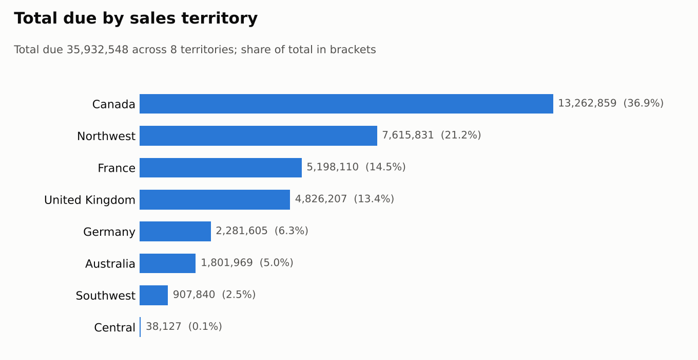
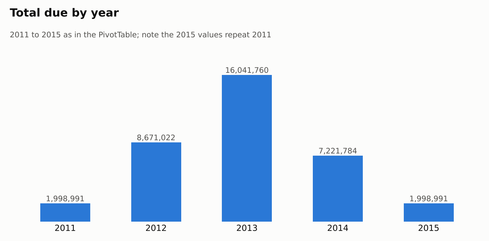
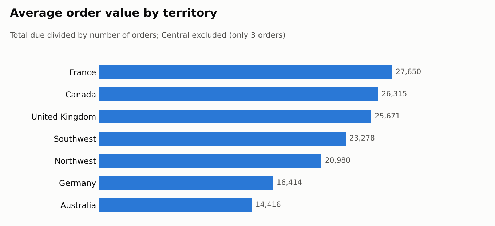

# Sales Analysis by Territory and Year (Excel Power Query + Power Pivot)

> A Power Pivot analysis of 1,549 sales orders and 35.9M in total due across 8 sales territories. Canada and Northwest bring in 58% of the total, and 2013 was the strongest year.

## 🎯 Business Question

Where do sales come from, and how do they change over time? Specifically:

- Which sales territories generate the most revenue?
- How large is a typical order in each territory?
- How did sales change from year to year?
- How much of the total due is product value, tax and freight?

## 📁 Data

- **Source:** Sales orders data from a data analysis diploma assignment
- **Size:** 1,549 orders, 24,527 order lines, 88,358 units
- **Territories (8):** Canada, Northwest, France, United Kingdom, Germany, Australia, Southwest, Central
- **Measures:** # Orders, # Order Details, Qty, Subtotal, Tax Amount, Freight, TotalDue

## 🛠️ Tools

Microsoft Excel: Power Query, Data Model (Power Pivot), PivotTables, slicer, PivotChart

## 🔄 Process

1. **Loaded the sales orders table with Power Query** and reshaped the measures into an Item / Value layout, so one field holds every measure.
2. **Added the data to the Excel Data Model** (Power Pivot) to use as the source for the PivotTables.
3. **Built two PivotTables:**
   - all seven measures by sales territory
   - total due by year and territory
4. **Added a slicer** on the measure name, so one PivotTable can switch between measures, and a **line chart** of total due by year and territory.
5. **Checked the totals:** the territory figures add up to the grand total of 35,932,548, and Subtotal + Tax + Freight comes to within 4 of it.

## 🔍 Key Findings

- **Canada and Northwest bring in 58.1% of total due.** Canada leads with 13,262,859 (36.9%), followed by Northwest with 7,615,831 (21.2%).
- **Four territories make up 86%.** Canada, Northwest, France (5,198,110) and the United Kingdom (4,826,207) lead. Central is almost empty, with only 3 orders and 38,127 in total due.
- **France has the largest orders**, at an average of 27,650 per order, compared with 23,197 across all territories. Australia has the smallest (14,416 per order), so its low total comes from smaller orders as well as fewer of them.
- **2013 was the peak year** at 16,041,760, which is 85.0% higher than 2012. 2014 fell 55.0% from 2013 to 7,221,784.
- **Product value makes up most of the total.** Subtotal is 88.7% of total due, tax is 8.6% and freight is 2.7%, and the tax and freight shares are almost the same in every territory.

## ⚠️ Data Notes

- The 2015 row in the year PivotTable repeats the 2011 values exactly (1,323,329 in Canada and 675,662 in Northwest). 2015 is kept in the charts and totals as it appears in the workbook, but check it against the source data before relying on the 2011 and 2015 figures.
- The 2014 total may cover only part of the year. Check the order dates before treating the 2014 drop as a real decline.
- The workbook's currency is not stated, so values are shown as plain amounts.

## ✅ Recommendations

- **Protect and grow Canada and Northwest**, since they carry more than half of the revenue.
- **Look at why Australia and Germany have smaller orders** (product mix, pricing or discounts), and test bundles or minimum-order offers there.
- **Learn from France, the UK and Canada**, which have the largest orders, and see whether their approach works in other territories.
- **Fix the date issues first** (the 2015 duplicate and possible partial 2014) before using the yearly trend for forecasting.

## 📂 Files

- `workbook/sales-territory-powerpivot.xlsx` – the Excel workbook with the Data Model, PivotTables, slicer and chart
- `images/` – charts used in this README

## 👤 Author

Mohamed EL Maghawry · [LinkedIn](https://www.linkedin.com/in/mohamed-el-maghawry-a60232b4) · maghawry.17@gmail.com
